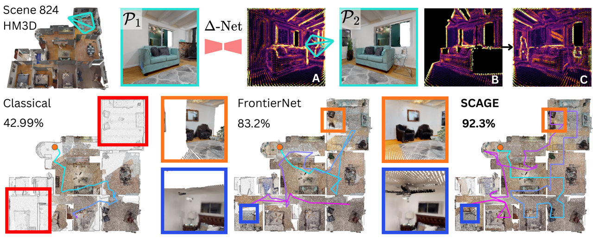
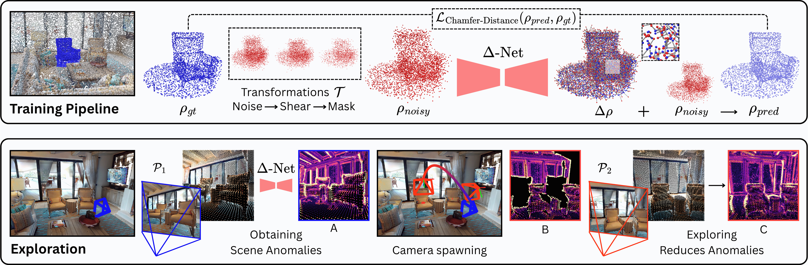
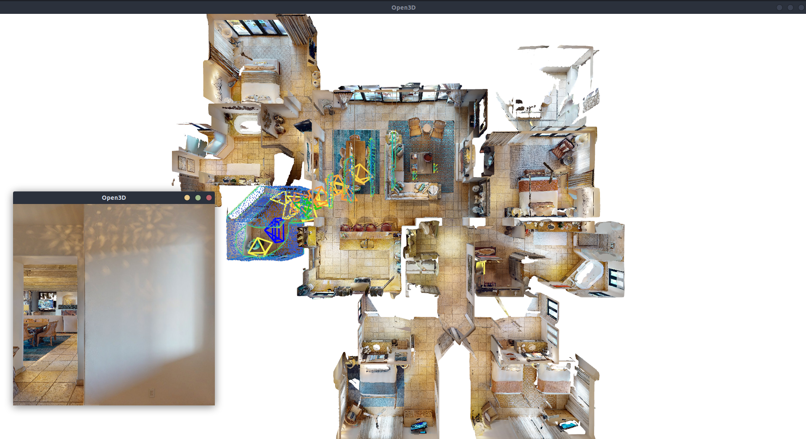

<div align="center">
    <h1>Beyond-Frontiers: Scene-Anomaly Guided Autonomous Exploration<br>
        <span style="font-size:0.6em;">IROS 2026</span>
    </h1>
    <p style="font-size:1.1em;">
        🎉 Best Paper Award at the
        <a href="https://bridging-navigation.github.io/website/">Bridging Perspectives in Navigation</a>
        workshop
    </p>
    <p style="font-size:1.2em;">
        <a href="https://akash-kumbar.github.io/">Akash Kumbar</a>,
        <a href="https://abhinav7r.github.io/">Abhinav Raundhal</a>,
        <a href="https://madhavak-iiith.github.io/">Madhava Krishna</a>
    </p>
    <p style="font-size:1.1em;">
        <a href="https://beyondfrontiers.github.io/">Project page</a> |
        <a href="https://arxiv.org/abs/2607.15828">arXiv</a> |
        <a href="https://www.youtube.com/watch?v=lEdourIT6Tw">Video</a>
    </p>
</div>

<p align="center"></p>

SCAGE uses Δ-Net to find **scene anomalies**: parts of the point cloud that
are unexplored or poorly reconstructed. It then flies the robot to the views
that resolve them.

<p align="center"></p>

## Install

```bash
conda create --name beyondfrontiers python=3.11 -y
conda activate beyondfrontiers
pip install torch==2.5.1 --index-url https://download.pytorch.org/whl/cu124
CMAKE_POLICY_VERSION_MINIMUM=3.5 pip install -r requirements.txt
```

Download the Δ-Net weights from [Hugging Face](https://huggingface.co/Sky6573/beyond-frontiers-delta-net):

```bash
mkdir model_weights
wget -P model_weights https://huggingface.co/Sky6573/beyond-frontiers-delta-net/resolve/main/delta_net.pth
```

You need a CUDA GPU with about 5 GB free.

## Run

**Δ-Net on a single example.** Shows the anomaly scores and a camera target for
each anomaly. Press C to switch to RGB colours.

```bash
python demo_single.py                                   # a point cloud from HM3D
python demo_single.py --depth examples/d455_desk.npz    # a real RealSense depth map
```

> [!NOTE]
> Δ-Net works best on point clouds in the orientation it was trained in, the
> Matterport3D / HM3D frame: z up along gravity, in metres. For depth maps
> from a depth camera or a monocular depth estimator, first remove flying
> pixels with `filter_flying_pixels`, then convert the cloud to that frame.
> Both steps are in `demo_single.py` (`filter_flying_pixels` and
> `depth_to_cloud`).

**Exploration**

```bash
python scage_explore.py --mesh examples/mv2HUxq3B53.glb --write_path output/run.json
```

<p align="center"></p>

- Press SPACE to start, or add `--auto_start` to start right away.
- **Big window:** the scene from above, with the anomaly scores (blue → red),
  the targets and the robot (blue).
- **Small window:** the robot's camera. Keep the mouse out of it while the
  robot is moving.
- `--write_path output/run.json` also saves the final coloured point cloud
  (`run_cloud.ply`) and the robot's path (`run_path.ply`).


## Acknowledgements

The simulator, mapping and planning are built on
[FrontierNet](https://github.com/cvg/FrontierNet), and the Δ-Net backbone is
[Point Transformer V3](https://github.com/Pointcept/PointTransformerV3).
Details of the network are in `deltanet/README.md`.

We are grateful to the authors of both works for making their code public,
which made research like ours possible.

The work was funded by [MeitY, Govt. of India](https://www.meity.gov.in/), under the project "Capacity Building for Human Resource Development in Unmanned Aircraft System (Drone and Related Technology)." 

## Citation

```bibtex
@InProceedings{BeyondFrontiers_2026_IROS,
    author    = {Kumbar, Akash and Raundhal, Abhinav and Krishna, Madhava},
    title     = {Beyond Frontiers: Scene-Anomaly Guided Autonomous Exploration},
    booktitle = {2026 IEEE/RSJ International Conference on Intelligent Robots and Systems (IROS)},
    year      = {2026},
}
```
